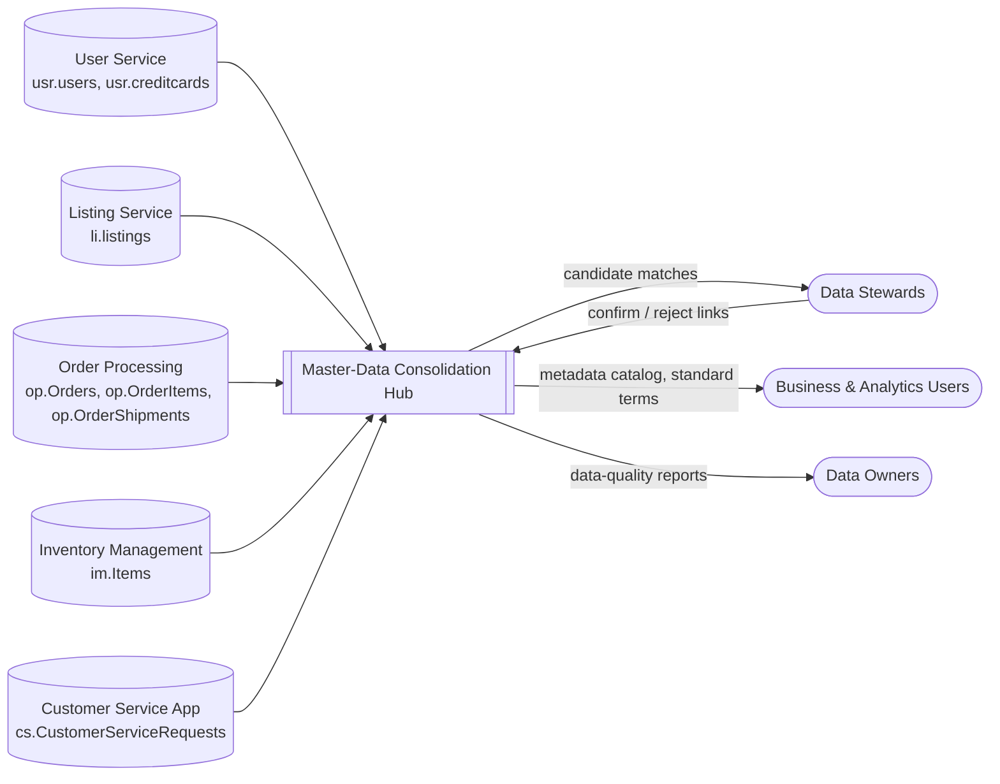
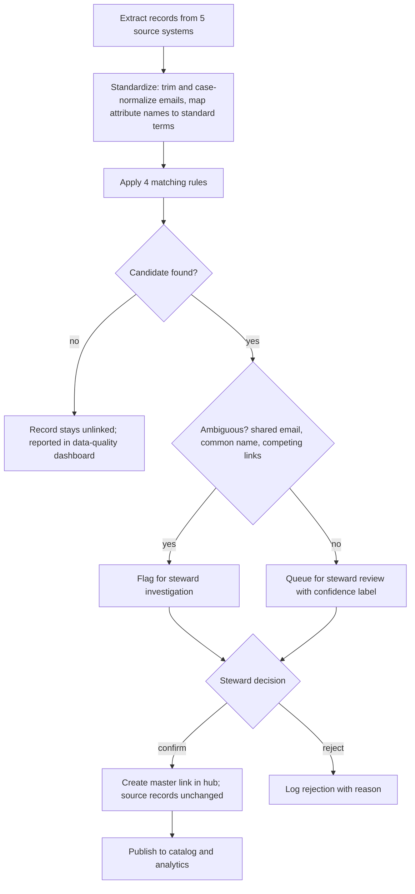

# Business Analysis — Retail Data Governance and Master-Data Matching

**Author:** Feras Elghandour · **Type:** Business analysis package for a data governance case study
**Related files:** [DESIGN.md](DESIGN.md) · [catalog/data_dictionary.csv](catalog/data_dictionary.csv) · [sql/postgresql_matching.sql](sql/postgresql_matching.sql) · [matching.py](matching.py) · [tests/](tests/)

> **Scope note.** This package documents the business analysis behind the case study (a sneaker resale marketplace): problem, stakeholders, current-state findings, target process, requirements and acceptance criteria. Matching output is a set of *candidate* links for data-steward review, not automatic merges. Retention periods, SLAs and compliance targets are assumptions requiring organizational review. No enterprise deployment or measured data-quality improvement is claimed.

---

## 1. Business problem

Customer, listing, order, inventory and support data live in five separate systems. The same customer or item is described differently in each, so the business cannot reliably answer basic questions — *who is this customer across systems, which listing corresponds to which physical item, what is the true status of an order?* — and personal and payment data are held in more places than necessary.

## 2. Objectives and success measures

| Objective | Success measure |
|---|---|
| One governed view of customers and items | % of records with a reviewed master link |
| Consistent business vocabulary | Number of conflicting attribute names / free-text status values resolved |
| Lower privacy and payment risk | Full card numbers stored (target: zero; tokenized instead) |
| Visible data quality | Orphan listings, missing emails and duplicate attributes reported per period |
| Safe matching | No automatic overwrite of source records |

## 3. Scope

**In scope:** metadata dictionary (8 tables, 5 systems), conceptual data model, 4 candidate-matching rules, quality controls, governance ownership, consolidation-style master-data hub design.
**Out of scope:** replacing source systems, real-time integration, production MDM tooling selection.

## 4. Stakeholders

| Stakeholder | Interest / role |
|---|---|
| Data owners (per source system) | Accountable for their system's data and definitions |
| Data stewards | Review candidate matches and resolve conflicts |
| Customer service | Needs a complete customer and order picture |
| Operations / warehouse | Needs listings tied to physical inventory items |
| Finance | Needs consistent order and payment records |
| Privacy / security | Minimizes personal and payment data |
| Analytics / BI | Consumes standardized, trusted data |

## 5. Context diagram

## 6. Current-state findings (from the metadata dictionary)

| # | Finding | Business impact |
|---|---|---|
| F-01 | Full card numbers stored in `usr.creditcards` | Payment-data exposure; should be tokenized |
| F-02 | Same attributes named differently: `ShoeType`/`Type`, `Brand`/`BrandName`, `Gender`/`Sex` | Reports and joins break; inconsistent definitions |
| F-03 | Order `Status`, `ContactReason`, `Resolution` are free text | No reliable status or root-cause reporting |
| F-04 | Customer name duplicated in support tickets | Conflicting customer details across systems |
| F-05 | No foreign key from `im.Items` and support tickets to users | Orphan records; weak lineage |
| F-06 | Support email optional | Customer matching needs a fallback rule |

## 7. Process map — candidate matching and stewardship (to-be)

## 8. Use cases

**UC-01 Generate customer match candidates** — Actor: System. Normalizes non-empty emails across user and support records and proposes matches; falls back to full name when the support email is missing.
**UC-02 Generate item match candidates** — Actor: System. Proposes listing-to-inventory matches by seller plus item attributes, and by seller/type/gender within a 45-day listing window.
**UC-03 Review a candidate match** — Actor: Data steward. Reviews evidence and rule label → confirms or rejects; source records are never overwritten.
**UC-04 Look up a standard definition** — Actor: Business or analytics user. Searches the metadata catalog for a term, its source tables and owner.
**UC-05 Monitor data quality** — Actor: Data owner. Reviews orphan listings, missing emails and duplicate attributes for their system.

## 9. Matching rules (business rules)

| ID | Rule | Confidence label | Known limitation |
|---|---|---|---|
| MR-1 | Exact match on normalized, non-empty email | High | Emails can be shared or reassigned |
| MR-2 | Full-name match when support email is absent | Lower | Common names collide |
| MR-3 | Same seller plus matching item attributes | Medium | Sellers can own identical items |
| MR-4 | Same seller, type and gender within 45 days of listing | Lower | Time window is an assumption |

Governing rule: **no match proves identity** — every candidate requires steward review.

## 10. Functional requirements

| ID | Requirement | Priority |
|---|---|---|
| FR-01 | Maintain a metadata dictionary for all 8 tables: entity, system, column, type, required, unique, keys, description | Must |
| FR-02 | Map conflicting attribute names to one standard business term | Must |
| FR-03 | Generate candidate matches with MR-1 to MR-4 and label each with its rule | Must |
| FR-04 | Exclude blank emails from email matching | Must |
| FR-05 | Route candidates to stewards; never merge or overwrite source records automatically | Must |
| FR-06 | Replace free-text order status with a controlled vocabulary | Should |
| FR-07 | Report orphan listings, missing emails and duplicate attributes per system | Should |

## 11. Non-functional requirements

| ID | Category | Requirement |
|---|---|---|
| NFR-01 | Privacy / PCI | Store a payment-provider token, never a full card number |
| NFR-02 | Data minimization | Hold only the personal attributes needed for matching |
| NFR-03 | Auditability | Log every steward decision with reason and timestamp |
| NFR-04 | Separation | Hub runs alongside source systems without changing their operation |
| NFR-05 | Portability | Matching rules expressed in PostgreSQL, with a SQLite adapter for testing |

## 12. Acceptance criteria (traced to the test suite)

| Req | Given / When / Then | Test evidence |
|---|---|---|
| FR-03 | Given the same email in user and support records with different case and surrounding spaces, when MR-1 runs, then one HIGH-confidence EXACT_EMAIL candidate is returned | normalized email test |
| FR-04 | Given blank emails on both sides, when MR-1 runs, then no candidate is returned | blank-email rejection test |
| FR-05 | Given two users sharing one email, when MR-1 runs, then both candidates are surfaced for review, not merged | shared-email ambiguity test |
| FR-03 | Given a support record with no email, when matching runs, then MR-2 name fallback is applied | missing-email fallback test |
| FR-03 | Given one listing pair inside and one just outside the 45-day window, when MR-4 runs, then only the in-window pair is a candidate | 45-day boundary test |

Run: `python -m unittest discover -s tests -v`

## 13. Governance roles (RACI)

| Activity | Data owner | Data steward | Privacy | Analytics |
|---|---|---|---|---|
| Define standard terms | A | R | C | C |
| Review candidate matches | I | R/A | – | I |
| Approve retention and access policy | A | C | R | I |
| Monitor data quality | A | R | – | C |

R = Responsible · A = Accountable · C = Consulted · I = Informed
